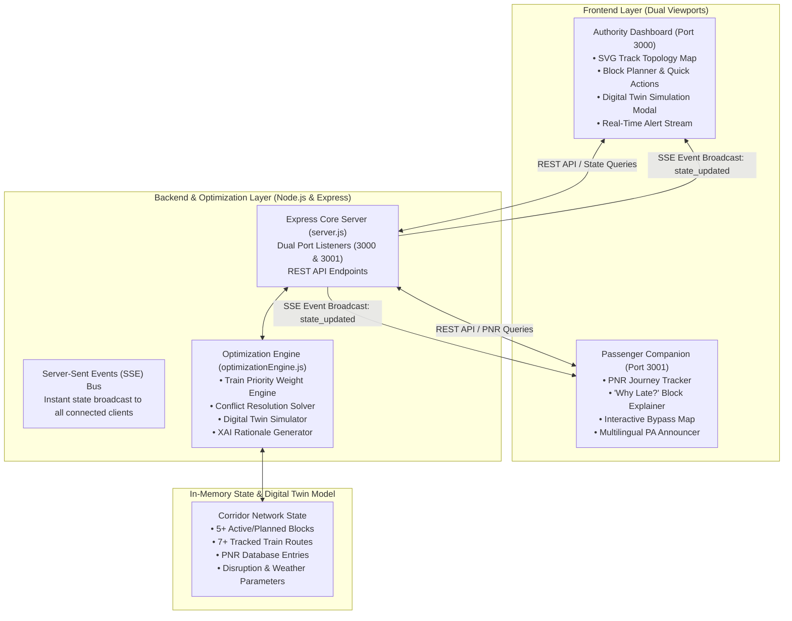

# 🚆 RailOpt AI — AI-Powered Automatic Block Planning System

[](https://www.sih.gov.in/)
[-blue.svg?style=for-the-badge&logo=subway)](https://ser.indianrailways.gov.in/)
[](https://nodejs.org/)
[](https://expressjs.com/)
[-red.svg?style=for-the-badge&logo=socketdotio)](https://developer.mozilla.org/en-US/docs/Web/API/Server-sent_events)
[](LICENSE)

> **RailOpt AI** is an intelligent, digital-twin-backed railway traffic optimization and automated maintenance block planning system built for the **Kharagpur Division (South Eastern Railway Corridor)**. It enables railway operational authorities to resolve section conflicts and dynamic reroutes with Explainable AI (XAI) while providing passengers real-time journey transparency and station voice announcements.

---

## 📌 Table of Contents

- [Problem Statement & Background](#-problem-statement--background)
- [System Highlights](#-system-highlights)
- [Dual-Interface Architecture](#-dual-interface-architecture)
- [System Architecture](#-system-architecture)
- [Core Features & Innovation](#-core-features--innovation)
  - [1. Intelligent Block Scheduling & Conflict Resolution](#1-intelligent-block-scheduling--conflict-resolution)
  - [2. Dynamic Reroute Engine & Topology Visualization](#2-dynamic-reroute-engine--topology-visualization)
  - [3. Digital Twin Simulation Sandbox](#3-digital-twin-simulation-sandbox)
  - [4. Explainable AI (XAI) Rationale](#4-explainable-ai-xai-rationale)
  - [5. Passenger Transparency & Journey Explainer](#5-passenger-transparency--journey-explainer)
  - [6. Multilingual Station PA Audio Announcement](#6-multilingual-station-pa-audio-announcement)
- [Live Corridor Topology & Test Data](#-live-corridor-topology--test-data)
- [API Reference](#-api-reference)
- [Quick Start Guide](#-quick-start-guide)
- [Repository Structure](#-repository-structure)
- [Future Roadmap](#-future-roadmap)
- [Author & Acknowledgments](#-author--acknowledgments)

---

## 🎯 Problem Statement & Background

### **SIH Problem Code: SIH26027**
In modern railway networks like Indian Railways, track maintenance (Track Renewal Work — TRW, Overhead Equipment — OHE, Signal & Telecom — S&T inspections) requires **block possessions** where sections are closed to normal traffic. 

### **The Challenge:**
1. **Compounding Cascading Delays:** A single unoptimized block can cause cascading delays across dozens of passing trains, snowballing thousands of delay minutes.
2. **Manual Disjointed Planning:** Section controllers often manually manage line blocks using spreadsheets and phone calls, making dynamic conflict resolution difficult.
3. **Passenger Information Asymmetry:** Passengers stuck at outer signals typically see vague delay statuses without knowing the underlying reason (e.g., active ballast cleaning machine 10 km ahead).

### **The RailOpt AI Solution:**
RailOpt AI integrates a **Mixed-Integer / Heuristic Railway Scheduling Engine** with a real-time **Digital Twin Corridor Sandbox**. When maintenance blocks are initiated or rescheduled, the system dynamically recomputes priority paths, evaluates bypass corridors, reduces total network delay by up to **50%+**, and transparently broadcasts real-time updates to both section controllers and passengers.

---

## ✨ System Highlights

- ⚡ **Automated Block Optimization:** Rebalances line possessions and saves hundreds of delay minutes across passenger, express, and freight services.
- 🔀 **Dynamic Intelligent Rerouting:** Automatically bypasses congested or blocked corridors (e.g., diverting premium services via Tatanagar & Kharagpur trunk lines).
- 🧪 **Digital Twin Stress Testing:** Allows controllers to simulate disruptions like monsoon heavy rainfall, dense fog, loco breakdowns, or freight surges before executing changes.
- 💡 **Explainable AI (XAI):** Gives transparent feature attribution scores (Train Priority Weight, Safety Headway, Maintenance Penalty, Asset Availability).
- 📱 **User POV Passenger Companion:** Real-time PNR tracking, visual delay explainers ("Why Late?"), route detour maps, and ETA predictions.
- 🎙️ **Multilingual Station Audio Broadcasts:** Generates official Indian Railways-style Public Address announcements in **Hindi and English** using client-side Speech Synthesis.
- 🔄 **Real-Time Cross-App Sync:** Synchronizes Authority actions and Passenger views instantly using Server-Sent Events (SSE).

---

## 🖥️ Dual-Interface Architecture

RailOpt AI delivers a unified backend powering two coordinated interfaces:

| Interface | URL | Target User | Key Capabilities |
|-----------|-----|-------------|------------------|
| **Authority Dashboard** | `http://localhost:3000` | Section Controllers, Chief Controllers, DRM Operations | Corridor topology map, live train tracking, block creation & rescheduling, MILP optimization, digital twin simulation, alert feed |
| **Passenger Companion** | `http://localhost:3001` | Train Passengers & General Public | PNR lookup, interactive track block explainer, journey timeline, delay notifications, dual-language PA announcements |

---

## 🏗️ System Architecture



---

## 🚀 Core Features & Innovation

### 1. Intelligent Block Scheduling & Conflict Resolution
- Calculates train priority weights using standard Indian Railways priority hierarchy:
  - **Vande Bharat Express** ($w = 1.0$)
  - **Rajdhani Express** ($w = 0.98$)
  - **Shatabdi Express** ($w = 0.95$)
  - **Duronto Express** ($w = 0.90$)
  - **Mail / Superfast Express** ($w = 0.70$)
  - **Ordinary Passenger** ($w = 0.50$)
  - **Freight Trains** ($w = 0.30$)
- Dynamically reschedules maintenance windows or reroutes high-priority rakes to minimize overall network dwell time.

### 2. Dynamic Reroute Engine & Topology Visualization
- Visual SVG rail topology covering:
  - `MURI` (Muri Junction)
  - `BKSC` (Bokaro Steel City)
  - `DHN` (Dhanbad Junction)
  - `ASN` (Asansol Junction)
  - `DGR` (Durgapur)
  - `TATA` (Tatanagar Junction)
  - `KGP` (Kharagpur Junction)
  - `HWH` (Howrah Junction)
- When a track block is active (e.g. `B-127` on MURI-BKSC), RailOpt AI activates an alternate trunk bypass via `TATA - KGP - HWH`, instantly saving **45+ minutes** for premium services like Train 20898 Vande Bharat.

### 3. Digital Twin Simulation Sandbox
- Enables controllers to test scenarios before committing decisions to live signaling systems:
  - **Weather Disruptions:** Heavy Monsoon Rain (+25m impact) or Dense Winter Fog (+40m impact).
  - **Asset Breakdown:** Signal / Locomotive failure (+45m impact).
  - **Freight Surges:** +40% goods train congestion penalty.
- Reports predicted delays, conflict counts, and asset utilization score in real-time.

### 4. Explainable AI (XAI) Rationale
RailOpt AI doesn't just output a plan—it explains **why** decisions were made:
- **Feature Attribution Breakdown:**
  - Train Priority Weight: **42%**
  - Safety Headway Margin: **28%**
  - Maintenance Urgency: **18%**
  - Rolling Stock & Asset Utilization: **12%**
- Outlines exact trade-offs (e.g., *"+18 km track distance traveled vs. 45 minutes net delay eliminated"*).

### 5. Passenger Transparency & Journey Explainer
- **Why Late? Modal:** Translates technical railway jargon into understandable passenger updates (e.g., explaining that Track Renewal Work with a Ballast Cleaning Machine is underway).
- **Interactive Journey Timeline:** Shows current signal hold status, expected delay reduction, and live reroute progress.
- **Instant PNR Lookup:** Preloaded with live sample PNRs for fast demonstration.

### 6. Multilingual Station PA Audio Announcement
- Built-in station announcer with Indian Railways acoustic cues:
  - **Hindi Announcement:** *“यात्री कृपया ध्यान दें... गाड़ी संख्या 20898 रांची से हावड़ा जाने वाली वंदे भारत एक्सप्रेस...”*
  - **English Announcement:** *“May I have your attention please. Train number 20898 Ranchi to Howrah Vande Bharat Express is diverted via Tatanagar and Kharagpur...”*

---

## 🗺️ Live Corridor Topology & Test Data

### Tracked Trains
| Train No. | Name | Primary Route | Default Delay | Optimized Delay | Priority Status |
|:---------:|:-----|:--------------|:-------------:|:---------------:|:---------------:|
| **20898** | Ranchi - Howrah Vande Bharat Exp | RNC - MURI - BKSC - HWH | 52 mins | **15 mins** | Premium (High) |
| **12019** | Howrah - Ranchi Shatabdi Exp | HWH - ASN - DHN - BKSC | 48 mins | **14 mins** | Premium (High) |
| **12810** | Howrah - Mumbai CSMT Mail | HWH - KGP - TATA - NGP | 38 mins | **17 mins** | Express (Medium) |
| **12262** | Howrah - Mumbai Duronto Exp | HWH - KGP - TATA - BSP | 31 mins | **14 mins** | Premium (High) |
| **12860** | Gitanjali Express (HWH - CSMT) | HWH - KGP - TATA - ROU | 25 mins | **11 mins** | Express (Medium) |
| **12839** | Howrah - Chennai Mail | HWH - KGP - VSKP - MAS | 18 mins | **8 mins** | Express (Medium) |
| **12301** | Howrah - New Delhi Rajdhani Exp | HWH - ASN - DHN - NDLS | 12 mins | **5 mins** | Premium (High) |

### Sample PNRs for Testing
Use any of these in the **Passenger App (`http://localhost:3001`)**:
- `1234567890` — **Jayashree** (Train 20898, Exec Chair Car E1-18)
- `2089800001` — **Rajesh Sharma** (Train 20898, Exec Chair Car E1-12)
- `1226200045` — **Amit Kumar** (Train 12019 Shatabdi Express, CC-34)

---

## 📡 API Reference

Both ports expose the complete REST and SSE interface:

| Method | Endpoint | Description |
|:------:|:---------|:------------|
| `GET` | `/api/state` | Retrieves complete corridor status, trains, blocks, and KPIs |
| `GET` | `/api/pnr?pnr=<number>` | Returns specific passenger journey, seat, and block impact details |
| `POST` | `/api/optimize/apply` | Runs `solveOptimization()` heuristic and applies optimized schedule |
| `POST` | `/api/optimize/reset` | Resets network schedule back to initial baseline |
| `POST` | `/api/reroute/toggle` | Toggles dynamic bypass for Vande Bharat (via Tatanagar / Kharagpur) |
| `POST` | `/api/simulate` | Runs Digital Twin simulation with weather, breakdown, or surge options |
| `POST` | `/api/blocks/create` | Creates a new planned line block possession |
| `POST` | `/api/blocks/reschedule`| Reschedules timing and reason for an existing track block |
| `GET` | `/api/events` | Server-Sent Events (SSE) stream broadcasting real-time updates |

---

## 💻 Quick Start Guide

### Prerequisites
- **Node.js** (v16.0.0 or higher recommended)
- **npm** (bundled with Node.js)
- Modern web browser (Chrome, Edge, Firefox, Safari)

### 1. Clone the Repository
```bash
git clone https://github.com/om-jena27/RailOpt-AI.git
cd RailOpt-AI
```

### 2. Install Dependencies
```bash
npm install
```

### 3. Launch the Application

#### Option A: One-Click Launcher (Windows)
Double-click `run.bat` or run:
```bat
start_prototype.bat
```
*(This automatically checks dependencies, boots the Express servers, and opens both dashboards in your browser!)*

#### Option B: Standard Terminal Execution
```bash
npm start
```

### 4. Open Interfaces in Browser
- 🚆 **Authority Dashboard:** [http://localhost:3000](http://localhost:3000)
- 📱 **Passenger Tracking App:** [http://localhost:3001](http://localhost:3001)

---

## 📂 Repository Structure

```text
RailOpt-AI/
├── optimizationEngine.js          # MILP / Heuristic Optimization & Digital Twin Solver
├── server.js                      # Express dual-port server & SSE broadcast engine
├── package.json                   # Project metadata & dependencies
├── run.bat                        # Quick launch wrapper script
├── start_prototype.bat            # Automated launcher for both web portals
├── start_authority_dashboard.bat  # Launcher for Authority view only (Port 3000)
├── start_passenger_app.bat        # Launcher for Passenger view only (Port 3001)
├── public/
│   ├── authority/                 # Authority Dashboard frontend assets
│   │   ├── index.html             # SVG corridor visualizer, KPI metrics, XAI cards
│   │   ├── app.js                 # UI controllers, SSE client, simulation modal
│   │   └── style.css              # Custom styling & radar effects
│   └── user/                      # Passenger POV mobile web frontend
│       ├── index.html             # PNR search, "Why Late?" tab, detour map
│       ├── app.js                 # PNR lookups, Web Speech PA announcer, SSE sync
│       └── style.css              # Clean mobile-responsive styling
└── README.md                      # Comprehensive project documentation
```

---

## 🔮 Future Roadmap

- [ ] **FOIS / COA Integration:** Direct API ingestion from Indian Railways Freight Operations Information System (FOIS) and Control Office Application (COA).
- [ ] **IoT Track Health Telemetry:** Integration with axle counters, track circuit relays, and drone-based visual inspection feeds.
- [ ] **Deep Reinforcement Learning (DRL):** Multi-agent scheduling models for handling mega-junction bottlenecks (e.g., Howrah & Mughalsarai / DDU).
- [ ] **SMS / WhatsApp Gateway:** Automated push alerts for passengers informing them of calculated arrival times and alternative connecting trains.

---

## 👨‍💻 Author & Acknowledgments

- **Lead Developer:** Om Jena ([@om-jena27](https://github.com/om-jena27))
- **Project Initiative:** Developed for **Smart India Hackathon (SIH26027)** — *AI-Powered Automatic Block Planning System*.
- **Special Thanks:** Indian Railways engineering teams, South Eastern Railway operational guidelines, and open-source contributors.

---

<p align="center">
  <b>RailOpt AI — Transforming Railway Line Possessions with Artificial Intelligence 🚆⚡</b>
</p>
